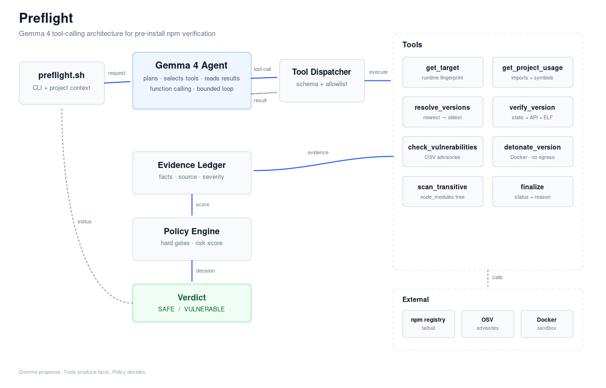

# Preflight

**Verify an npm package before it reaches your machine.**

Preflight installs the package in a disposable container, inspects its code and native binaries, checks known vulnerabilities, and returns one verdict:

```json
{"status":"SAFE"}
```

or

```json
{"status":"VULNERABLE"}
```



*Editable source: [`docs/architecture.drawio`](docs/architecture.drawio).*

## Why

Installing a package executes code. `npm audit` sees known CVEs; it does not see a malicious `postinstall`, a load-time payload, a transitive compromise, or a binary built for the wrong glibc.

Preflight answers four questions before install:

- Does the package still expose the API this project uses?
- Does it load on this OS, architecture, libc, and Node ABI?
- What does it do when installed and imported with no network?
- Does it carry known vulnerabilities or suspicious transitive dependencies?

## How Gemma 4 is used

Gemma 4 is the investigator, not the judge.

It receives a fixed tool schema, chooses which tool to call, reads the JSON result, and decides the next step. The model never executes package code; the runtime dispatches every call.

```text
CLI ──► Gemma 4 Agent ──► Tool Dispatcher ──► Tool
              ▲                                │
              └────────── result ─────────────┘
```

The loop:

1. `get_target` and `get_project_usage` establish the runtime and the symbols the project actually imports.
2. `resolve_versions` lists candidates, newest first.
3. `verify_version` downloads, scans, checks the API contract, and inspects native binaries.
4. If a used symbol is missing, Gemma tries the next older version.
5. `check_vulnerabilities`, `detonate_version`, and `scan_transitive` collect security evidence.
6. `finalize` proposes `SAFE` or `VULNERABLE`.

The policy engine computes the final verdict. Gemma can propose; it cannot override a critical advisory, a canary hit, or a glibc/ABI mismatch.

If `GEMINI_API_KEY` is absent or the API is unavailable, the deterministic pipeline runs the same tools in a fixed order.

## Tools

| Tool | Purpose |
|---|---|
| `get_target` | Return OS, architecture, libc, glibc version, Node version, and ABI. |
| `get_project_usage` | Extract the imported symbols, subpaths, and version range from the local project. |
| `resolve_versions` | List candidate versions that match the range and target constraints. |
| `verify_version` | Download, verify, extract, static-scan, check the API contract, and inspect ELF/glibc/ABI. |
| `check_vulnerabilities` | Query OSV for known advisories. |
| `detonate_version` | Install in Docker with scripts disabled; import with no network, fake HOME, and canary credentials; run lifecycle scripts with egress denied. |
| `scan_transitive` | Scan `node_modules` for install scripts, native binaries, and suspicious code. |
| `finalize` | End the investigation with a proposed status and reason. |

## How a package is scanned

1. Resolve the project's imports and the target fingerprint.
2. Walk versions newest to oldest until the used API exists.
3. Fetch the exact tarball and verify its integrity.
4. Run static analysis before any execution.
5. Inspect native binaries: GLIBC, GLIBCXX, Node ABI, architecture, interpreter.
6. Detonate in Docker: install, import, and lifecycle scripts with no egress.
7. Scan transitive dependencies.
8. Query OSV.
9. Evaluate evidence through hard gates and a risk score.
10. Return `SAFE` or `VULNERABLE`.

## Detection coverage

- Known CVEs via OSV.
- Risky lifecycle scripts: `preinstall`, `install`, `postinstall`, `prepare`, `binding.gyp`.
- Load-time payloads on `require()`.
- Credential access: `.npmrc`, SSH keys, cloud credentials.
- Network and DNS egress attempts.
- Encoded and obfuscated payloads.
- Transitive install scripts and native artifacts.
- glibc, GLIBCXX, Node ABI, libc, and architecture mismatches.
- Removed or missing APIs after a version upgrade.

## Usage

```bash
./preflight.sh <package[@version]> [status|--verbose|--json]
```

```bash
./preflight.sh ms
./preflight.sh vm2@3.9.16
./preflight.sh lodash@4.17.20 --verbose
```

With Gemma 4:

```bash
export GEMINI_API_KEY="..."
./preflight.sh vm2@3.9.16
```

Without a key, the deterministic pipeline runs. `--no-gemma` forces it.

Default output:

```json
{"status":"SAFE"}
{"status":"VULNERABLE"}
```

`review` and `block` map to `VULNERABLE`; `allow` and `allow_with_warnings` map to `SAFE`.

### Target override

```bash
PREFLIGHT_TARGET=ubuntu22-node20 ./preflight.sh vm2@3.9.16
```

Presets: `ubuntu22-node20`, `ubuntu24-node22`, `debian12-node20`, `alpine-node20`.

## Limits

- Not a proof of safety. A determined, environment-gated payload can evade dynamic analysis.
- ELF inspection reads metadata, not disassembly.
- Docker with `--network none` is containment, not a hardened boundary.
- OSV covers known vulnerabilities only.

## Repository layout

```text
preflight.sh                 single command
src/index.ts                 CLI and deterministic pipeline
src/agent.ts                 Gemma 4 tool-calling loop
src/gemma-client.ts          Gemini API client
src/usage.ts                 project import and API contract analysis
src/candidates.ts            version walk and declared compatibility
src/static.ts                code and lifecycle-script rules
src/elf.ts                   glibc, ABI, architecture inspection
src/sandbox.ts               Docker install and detonation
src/transitive.ts            node_modules tree scan
src/osv.ts                   vulnerability lookup
src/policy.ts                hard gates, risk score, verdict
preflight-sandbox/Dockerfile inspection image
docs/architecture.svg        architecture diagram
docs/architecture.drawio     editable diagram source
```

## License

MIT
